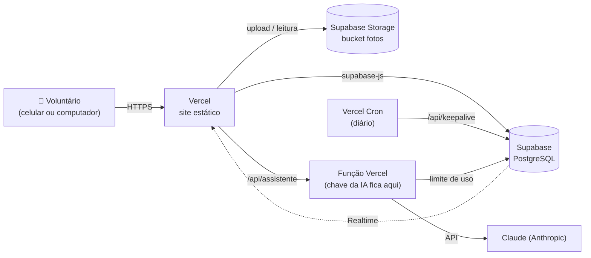
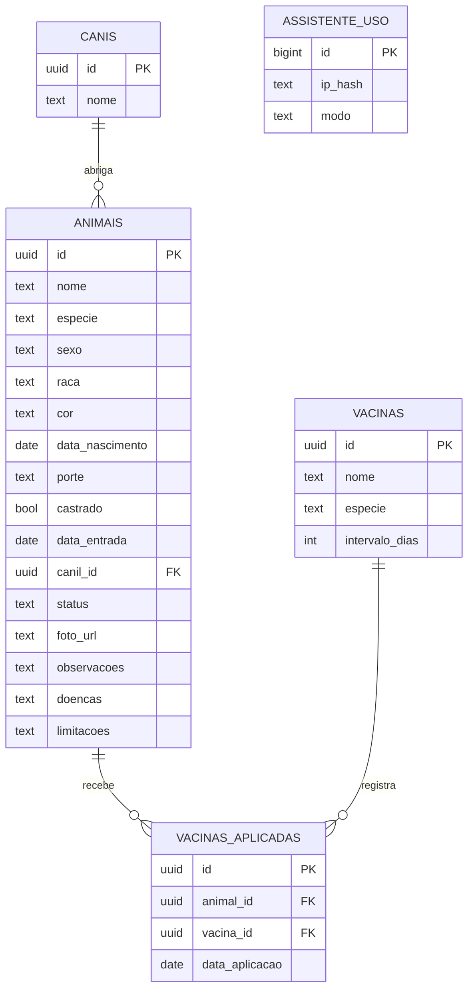

<div align="center">


# Patinhas

**Cadastro de animais, vacinas e canis para ONGs de proteção animal.**
Feito para voluntários que não entendem de tecnologia: botões grandes, textos claros em português e uso principalmente pelo celular, dentro do canil.

[](https://patinhas-canil.vercel.app)
[](https://patinhas-canil.vercel.app)
[](LICENSE)
[](https://supabase.com)


### 🌐 [**Abrir o aplicativo → patinhas-canil.vercel.app**](https://patinhas-canil.vercel.app)

</div>

---

## Links

| O quê | Endereço |
|---|---|
| **Site / aplicativo** | https://patinhas-canil.vercel.app |
| **Código-fonte** | https://github.com/D4NIELT0RRES/patinhas-canil |
| **Verificação de saúde do sistema** | https://patinhas-canil.vercel.app/api/keepalive |

O mesmo endereço serve como **site no computador** e como **aplicativo no celular** (veja [Instalar no celular](#instalar-no-celular)).

---

## O que o sistema faz

O Patinhas substitui planilhas e cadernos no dia a dia do canil. Com ele a ONG:

- **Cadastra cada animal** com foto, dados básicos, status, canil e observações livres;
- **Controla vacinas** de cada animal, com situação por cores e cálculo automático da próxima dose;
- **Organiza os canis e locais** e sabe quantos animais há em cada um;
- **Lista as pendências**: quem está com vacina faltando ou vencida, para agir rápido;
- **Encontra qualquer animal** em segundos, por busca livre, filtros e ordenação;
- **Tira dúvidas com uma IA** sobre alimentação, saúde e cuidados, com o contexto do animal;
- **Automatiza o trabalho chato**: preenche o cadastro pela foto, escreve o texto de adoção e avisa das vacinas antes de vencerem.

### Telas

| Tela | Para que serve |
|---|---|
| **Animais** | Lista em cards (foto, nome, raça, idade, cor, porte, canil e etiqueta de status). Busca grande no topo, filtros por canil, status, espécie, sexo, porte, cor e faixa de idade, e ordenação por nome, idade ou tempo na ONG. Botão fixo **+ Novo animal**. Mostra alerta de vacinas pendentes e indica quem tem observações. |
| **Cadastro / edição** | Formulário simples, cada campo com uma dica curta e um exemplo. Foto direto da câmera ou da galeria. |
| **Ficha do animal** | Foto grande e todos os dados. Idade e tempo na ONG calculados sozinhos (ex.: "2 anos e 3 meses"). Abas **Dados** e **Saúde**. Botões **Editar** e **Excluir** (com confirmação). |
| **Saúde** (na ficha) | Doenças, limitações e cuidados especiais, e a lista de vacinas da espécie do animal, com resumo "3 em dia, 1 vencida, 2 faltando". |
| **Vacinas** | Cada vacina é cadastrada **uma única vez**: nome, espécie (cachorro, gato ou ambos) e intervalo do reforço em dias. |
| **Canis** | Cadastrar, editar e remover locais, com a contagem de animais de cada um. |
| **Pendências** | Todos os animais com vacina faltando ou vencida. Toque para abrir direto a aba Saúde. |

### Recursos de IA e automação

| Recurso | Onde aparece | O que faz |
|---|---|---|
| **Assistente IA** | Botão no topo, em todas as telas | Responde dúvidas gerais: "cachorro pode comer banana?", sinais de alerta, banho, vermifugação. Traz sugestões de perguntas e um guia fixo de **o que pode e o que não pode comer** que funciona mesmo sem IA. |
| **Assistente na ficha** | Aba **Assistente** de cada animal | Responde já sabendo espécie, idade, porte, doenças, limitações e vacinas do animal. |
| **Preencher pela foto** | Cadastro do animal | Ao escolher a foto, a IA sugere espécie, porte, raça e cor, e só preenche os campos vazios. |
| **Texto de adoção** | Ficha do animal | Gera um texto carinhoso para divulgar, editável, com botões **Copiar** e **WhatsApp**. |
| **Grade ou lista** | Tela Animais | Alterna entre cards com foto grande e lista compacta (a escolha fica guardada no aparelho). No computador, a tecla `/` leva direto à busca. |
| **Galeria** | Aba **Galeria** | Carrossel de fotos dos animais que passa sozinho (e se pode arrastar), com miniaturas e filtros (todos, para adoção, cachorros, gatos). Tocar na foto abre um cartão com os dados, as vacinas e as observações, com setas para o próximo animal. |
| **Vacinação em grupo** | Pendências → botão no topo | Para o dia em que o veterinário vacina vários animais: escolha a vacina, a data e o canil, e marque quem tomou. Já vem marcado quem está com a vacina faltando ou vencida. Registra tudo de uma vez, com confirmação. |
| **Vacinas a vencer** | Lista, ficha e Pendências | Avisa as doses que vencem nos próximos 30 dias, antes de virarem pendência. |
| **Painel de números** | Topo da lista | Total de animais, disponíveis, em tratamento, com pendências e vacinas a vencer. |
| **Tempo real** | Listas, Vacinas, Canis e Pendências | Quando outro voluntário muda algo, a tela se atualiza sozinha (Supabase Realtime). |
| **QR Code** | Ficha do animal | Gera uma etiqueta com QR para imprimir e colar na baia. |

> A IA dá **dicas gerais e pode errar**: o app avisa que ela não substitui o veterinário. Em caso de emergência, procure um profissional.

---

## Como funciona

### Vacinas: a regra de cores

Para cada animal, o sistema mostra **todas as vacinas que se aplicam à espécie dele** e calcula a situação de cada uma:

| Situação | Cor | Regra |
|---|---|---|
| **Em dia** | 🟢 verde | Há dose registrada e `data da dose + intervalo` ainda não passou |
| **Vencida** | 🟠 laranja | Há dose registrada, mas o reforço já passou do prazo |
| **Falta** | 🔴 vermelho | Nenhuma dose registrada |

- Ao marcar a vacina como tomada, o app pede **só a data** (já sugerindo hoje) e calcula a **próxima dose**.
- **Nova dose** atualiza a data do reforço. Desmarcar apaga o registro (com confirmação).
- Animais com status **Adotado** não aparecem nas pendências nem recebem o alerta de vacina.

### Idade e tempo na ONG

Calculados a partir das datas de nascimento (aproximada) e de entrada, sempre em relação a **hoje**, então nunca ficam desatualizados. Exemplos: `menos de 1 mês`, `1 ano`, `2 anos e 3 meses`.

### Fotos

A foto é escolhida pela câmera ou galeria, **reduzida no próprio celular** (lado maior de 1200 px, JPEG) e enviada ao **Supabase Storage**. Isso deixa o envio rápido mesmo com internet fraca e faz o plano gratuito render por anos. Ao trocar a foto ou excluir o animal, o arquivo antigo é apagado, sem deixar lixo no armazenamento.

### Arquitetura



- **Sem servidor próprio e sem build:** o app é HTML, CSS e JavaScript puros, servidos como arquivos estáticos.
- **Sem login:** o app abre direto na lista de animais.
- **A chave da IA nunca vai para o navegador:** o site chama `/api/assistente`, uma função da Vercel que guarda a `ANTHROPIC_API_KEY`, monta as instruções e fala com o Claude.
- **Verificação diária:** uma tarefa agendada da Vercel faz uma leitura simples no banco todo dia. Isso evita que o projeto gratuito do Supabase seja **pausado por inatividade**.

### Modelo de dados



- Excluir um **canil** deixa seus animais "sem canil" (nenhum animal é apagado).
- Excluir um **animal** ou uma **vacina** apaga também os registros de vacinas ligados a eles.
- `assistente_uso` só controla o limite de perguntas à IA e guarda um código embaralhado (hash) de quem usou, nunca o IP; registros com mais de 2 dias são limpos.
- `vacinas_aplicadas` guarda **uma linha por animal e vacina**: a dose mais recente.

---

## Instalar no celular

O Patinhas pode ficar como um ícone na tela inicial, abrindo em tela cheia como um aplicativo.

- **Android (Chrome):** abra o link → menu ⋮ → **Instalar aplicativo** (ou *Adicionar à tela inicial*).
- **iPhone (Safari):** abra o link → botão de compartilhar ⬆️ → **Adicionar à Tela de Início**.

---

## Estrutura do projeto

```
.
├── index.html              Página única do aplicativo
├── manifest.webmanifest    Instalação como app no celular
├── vercel.json             Cabeçalhos de segurança e tarefa diária
├── package.json            Dependência da função de IA (@anthropic-ai/sdk)
├── api/
│   ├── assistente.js       Função da IA: chat, texto de adoção e análise de foto
│   └── keepalive.js        Função que mantém o Supabase ativo
├── css/styles.css          Visual (tema verde, fontes grandes)
├── icons/                  Ícones do aplicativo
├── js/
│   ├── config.js           URL e chave pública do Supabase
│   ├── utils.js            Datas, ícones, avisos e janelas
│   ├── api.js              Acesso ao Supabase, fotos e regras de vacinas
│   ├── animais.js          Lista, formulário e ficha do animal
│   ├── galeria.js          Carrossel de fotos e cartão do animal
│   ├── ia.js               Assistente, guia de alimentos, texto de adoção e foto
│   ├── outras.js           Vacinas, canis e pendências
│   └── app.js              Navegação entre telas
└── supabase/
    └── schema.sql          Tabelas, vacinas de exemplo, segurança e bucket de fotos
```

---

## Colocar no ar com o seu próprio Supabase

1. **Supabase:** crie um projeto gratuito em [supabase.com](https://supabase.com).
2. **Banco e fotos:** em *SQL Editor → New query*, cole todo o `supabase/schema.sql` e clique em **Run**. Isso cria as tabelas, as 6 vacinas de exemplo (V10, Antirrábica, Gripe canina, Giárdia, Leishmaniose e V4/V5 felina), as políticas de acesso e o bucket público `fotos`.
3. **Chaves:** em *Project Settings → API Keys*, copie a **Project URL** e a chave **publishable**, e cole em `js/config.js` (as funções em `api/` usam as variáveis `SUPABASE_URL` e `SUPABASE_ANON_KEY`, se definidas).
4. **Vercel:** importe este repositório em [vercel.com/new](https://vercel.com/new). Não precisa de configuração: o projeto é estático.
5. **IA (opcional):** crie uma chave em [console.anthropic.com](https://console.anthropic.com), defina um **limite de gasto mensal** lá e cadastre as variáveis abaixo na Vercel (*Project Settings → Environment Variables*). Depois faça um novo deploy.
6. Abra o endereço gerado e cadastre o primeiro canil.

| Variável | Obrigatória | Para que serve |
|---|---|---|
| `ANTHROPIC_API_KEY` | Sim, para a IA | Chave da API do Claude. Sem ela o app funciona normalmente e o assistente avisa que não está configurado. |
| `ANTHROPIC_MODEL` | Não | Modelo usado. Padrão: `claude-opus-5-5`. Use `claude-haiku-5-5` para gastar bem menos. |
| `LIMITE_HORA_POR_PESSOA` | Não | Perguntas por hora por pessoa (padrão 20). |
| `LIMITE_POR_DIA` | Não | Perguntas por dia no total (padrão 400). |
| `IP_SALT` | Não | Texto qualquer que embaralha o identificador de quem usa a IA. |

Para testar no computador, basta rodar `python3 -m http.server 8000` na pasta e abrir http://localhost:8000.

---

## Segurança: leia com atenção

O app **não tem login**, por decisão do projeto. Por isso as políticas de acesso (*Row Level Security*) liberam leitura e escrita para o cliente anônimo, e a chave `publishable` fica no código do site. Na prática:

- **quem tiver o endereço do site consegue ver e alterar os dados e as fotos**;
- compartilhe o link **apenas com voluntários de confiança** e evite divulgá-lo em redes sociais;
- o bucket de fotos aceita só imagens (JPEG, PNG e WebP) de até 5 MB;
- o assistente de IA é protegido por limites por pessoa e por dia, mas, como não há login, **qualquer pessoa com o link pode usá-lo e gerar custo**: defina um limite de gasto na Anthropic e prefira `claude-haiku-5-5` se quiser economizar;
- a chave da IA fica só no servidor da Vercel, nunca no código do site;
- não coloque no cadastro dados pessoais de adotantes.

Se a ONG quiser proteger o acesso no futuro, o caminho é adicionar login (Supabase Auth) e trocar as políticas `acesso_anonimo` por políticas que exijam usuário autenticado.

---

## Limites do plano gratuito

| Recurso | Limite gratuito | Situação no Patinhas |
|---|---|---|
| Banco de dados | 500 MB | Texto puro: cabem dezenas de milhares de animais |
| Armazenamento de fotos | 1 GB | Cada foto é reduzida (≈ 100–300 KB): milhares de fotos |
| Funções da Vercel | Plano gratuito (Hobby) | Uma chamada por pergunta à IA, limitada a 30 s |
| Pausa por inatividade | ~7 dias sem uso | Evitada pela tarefa diária `/api/keepalive` |

> Mesmo assim, **faça uma cópia de segurança de vez em quando**: no Supabase, *Table Editor → Export* exporta cada tabela em CSV. O plano gratuito não inclui backups automáticos.

---

## Tecnologias

- **Front-end:** HTML, CSS e JavaScript puros (sem framework e sem build), com menu lateral no computador e menu inferior no celular
- **Banco e arquivos:** [Supabase](https://supabase.com) (PostgreSQL + Storage) via `supabase-js`
- **IA:** [Claude](https://www.anthropic.com/claude) via `@anthropic-ai/sdk`, em função da Vercel
- **Tempo real:** Supabase Realtime
- **Hospedagem:** [Vercel](https://vercel.com) (site estático + função + tarefa agendada)
- **Fonte:** Inter (Google Fonts)

## Acessibilidade e uso no celular

- Botões e campos com no mínimo 48 a 56 px de altura, fonte base de 18 px;
- menu fixo na parte de baixo da tela no celular e botão **+ Novo animal** sempre visível;
- foco visível para navegação por teclado e rótulos para leitores de tela;
- respeita a preferência de movimento reduzido do sistema.

---

## Licença

Distribuído sob a [licença MIT](LICENSE): você pode usar, copiar, modificar e distribuir o código, inclusive em outras ONGs, mantendo o aviso de copyright.
